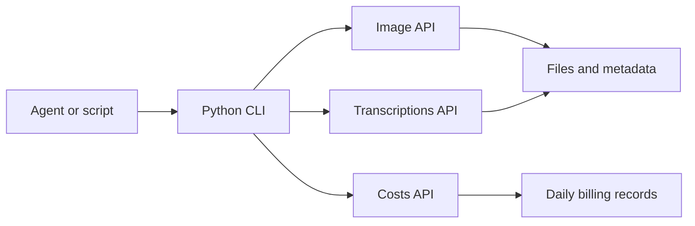

# Lanshu OpenAI Media API

**Image generation and speech transcription for agents, with structured usage records.**

[](https://github.com/cclank/lanshu-openai-media-api/actions/workflows/checks.yml)
[](https://www.python.org/)
[](https://developers.openai.com/api/docs)
[](#requirements)
[](#documentation)
[](LICENSE)
[](https://x.com/LufzzLiz)

[English](README.md) · [简体中文](docs/i18n/README.zh-CN.md) · [日本語](docs/i18n/README.ja.md) · [한국어](docs/i18n/README.ko.md) · [Français](docs/i18n/README.fr.md) · [العربية](docs/i18n/README.ar.md) · [Türkçe](docs/i18n/README.tr.md)

A small Python CLI and portable agent skill for calling OpenAI's image, transcription, and cost APIs. Generate an image or transcribe a recording, then keep the request ID, returned usage, and output paths together in a metadata file.

## Contents

- [Capabilities](#capabilities)
- [Curated models](#curated-models)
- [Requirements](#requirements)
- [Quick start](#quick-start)
- [Credentials](#credentials)
- [Agent integration](#agent-integration)
- [Outputs and billing](#outputs-and-billing)
- [Documentation](#documentation)
- [Development](#development)

## Capabilities

- **Generate images** with GPT Image 2.5 Sunburst or Flare, with size, quality, quantity, and format controls.
- **Transcribe files** with GPT-Transcribe, including multiple language hints and domain keywords.
- **Inspect cost records** using an organization admin credential, scoped to a project and optionally an API key and model.
- **Automate through JSON**: API execution results use a consistent success flag and process exit code.
- **Keep useful evidence**: successful media calls save request IDs, usage, HTTP status, elapsed time, and response metadata.
- **Use a portable skill**: the same implementation can run from a repository, an installed CLI, or an agent's skill directory.



## Curated models

| Task | Model | Selection |
| --- | --- | --- |
| Image generation with a focus on quality | `gpt-image-2.5-sunburst` | Image default |
| Fast everyday image generation | `gpt-image-2.5-flare` | Fast drafts |
| Audio/video file transcription | `gpt-transcribe` | Transcription default |

The catalog was checked against official documentation on **2026-10-29**. Explicit model choices are preserved; the CLI does not silently substitute another model.

```bash
python3 scripts/openai_media.py models
```

## Requirements

| Component | Requirement |
| --- | --- |
| Python | 3.9 or newer |
| Runtime Python packages | Standard library only |
| curl | Optional; preferred HTTP transport when installed |
| ffprobe | Optional; reads duration for audio formats beyond WAV |
| zsh | Optional; loads existing exports from `~/.zshrc` |
| Credentials | `OPENAI_API_KEY` for media; an admin credential for cost queries |

This project handles image generation and file transcription. Live microphone streaming, speaker diarization, and word-level timestamps are outside the current CLI.

## Quick start

Run commands from the repository directory. Configure an exported API key in your existing local environment before making a live media request; see [Credentials](#credentials).

### Generate an image

```bash
python3 scripts/openai_media.py image \
  --prompt "An orange cat on a sunny windowsill, natural photography, no text" \
  --out output/cat.png
```

Defaults: `gpt-image-2.5-sunburst`, one image, `1024x1024`, `medium` quality, PNG.

For a fast draft:

```bash
python3 scripts/openai_media.py image \
  --model gpt-image-2.5-flare \
  --prompt "A minimal ceramic coffee cup on a stone table" \
  --quality low \
  --out output/cup.png
```

Available controls include `--prompt-file`, `--size`, `--quality`, `--n`, and `--output-format png|jpeg|webp`. Use a fresh output filename; existing files are checked before a paid request.

Preview a request without reading credentials or calling the API:

```bash
python3 scripts/openai_media.py image \
  --prompt "A quiet mountain landscape" \
  --out output/landscape.png \
  --dry-run
```

### Transcribe audio

```bash
python3 scripts/openai_media.py transcribe \
  --input /absolute/path/recording.wav \
  --languages en \
  --keyword OpenAI \
  --out output/transcript.txt
```

Repeat `--languages` for expected languages, such as `--languages zh --languages en`. Use `--prompt` for recording context and repeated `--keyword` flags for relevant terms. An empty result is explicitly marked with `empty_transcript: true`.

### Read cost records

```bash
python3 scripts/openai_media.py costs \
  --date 2026-10-29 --timezone UTC \
  --project-id YOUR_PROJECT_ID \
  --key-name YOUR_KEY_NAME \
  --model gpt-image-2.5-sunburst \
  --out output/costs.json
```

Replace the identifiers and date with real values. Use `--api-key-id` instead of `--key-name` when the name is ambiguous. This command uses an admin credential.

### Install the command

The source script works without installation. For a console entry point, install into a virtual environment:

```bash
python3 -m venv .venv
source .venv/bin/activate
python -m pip install .
lanshu-openai-media-api models
```

## Credentials

| Variable | Used for |
| --- | --- |
| `OPENAI_API_KEY` | Image generation and transcription |
| `OPENAI_ADMIN_KEY` | Cost queries and key-name resolution |
| `OPENAI_ADMIN_API_KEY` | Supported alias for the admin credential |

Credential lookup follows this order:

1. An explicit `--env-file` selects an existing file and overrides the corresponding environment variable.
2. Otherwise, use the process environment.
3. If the export is absent, load it from an existing `~/.zshrc` through a new zsh process.

The shell's startup output is discarded, and the credential is read through a private memory pipe. `--no-shell-env` disables that fallback. An explicit credential file is parsed as literal assignments; its contents are not executed.

Keep keys in your existing local environment or credential file. No credential is bundled in the repository or skill archive. Admin credentials are used for cost queries, separately from media calls.

## Agent integration

The repository root contains a complete [SKILL.md](SKILL.md), [agent metadata](agents/openai.yaml), and the executable helpers. Agents can read the skill and run the documented commands directly.

Build a standalone skill package:

```bash
python3 tools/build_skill.py --output-dir dist
```

This creates:

```text
dist/
├── lanshu-openai-media-api/
├── lanshu-openai-media-api.zip
└── lanshu-openai-media-api.manifest.json
```

Place the generated folder in your agent's skill directory. Codex commonly uses `~/.codex/skills/`. The invocation name is **`$lanshu-openai-media-api`**. Other hosts can use the same skill files or call the CLI directly.

The package includes five explicit source files and a checksum manifest alongside the archive. It excludes local credentials, audio recordings, generated images, and billing exports. Use `--force` to replace a previous build in the output directory.

## Outputs and billing

Successful media calls write the requested artifact and a sidecar:

```text
output/
├── cat.png
├── cat.metadata.json
├── transcript.txt
└── transcript.metadata.json
```

Metadata retains actual request parameters, returned usage, HTTP status, request ID, elapsed time, credential source, output paths, and response metadata. Image base64 and keys are excluded.

Operational behavior:

- POST requests are sent once, without automatic retries or model changes.
- GET requests retry a network error at most once.
- Existing output files or sidecars cause an error before a paid request.
- HTTP errors retain the API's reported cause, including string or object error responses.
- A request ID or usage record is distinct from a monetary charge.

Costs API results are **daily UTC aggregates**. Filtering by project, key, and model does not turn them into individual request receipts. For local dates, inspect `returned_daily_buckets` and `date_window_exact`; returned buckets may overlap the requested calendar day. Missing cost rows do not establish a free request.

For protocol details, dated pricing references, and official sources, read [API notes](references/api-notes.md).

## Documentation

English is the primary documentation. Localized guides cover setup, credentials, model selection, commands, outputs, and billing boundaries. Technical identifiers remain unchanged.

| Documentation | ASR language hint |
| --- | --- |
| [English](README.md) | `en` |
| [简体中文](docs/i18n/README.zh-CN.md) | `zh` |
| [日本語](docs/i18n/README.ja.md) | `ja` |
| [한국어](docs/i18n/README.ko.md) | `ko` |
| [Français](docs/i18n/README.fr.md) | `fr` |
| [العربية](docs/i18n/README.ar.md) | `ar` |
| [Türkçe](docs/i18n/README.tr.md) | `tr` |

Arabic prose is marked for right-to-left reading; command blocks retain left-to-right direction. Documentation localization and ASR language hints do not imply that every language has undergone a live recognition benchmark.

## Development

The protocol suite uses a local HTTP fixture and synthetic test data. It does not call OpenAI or need a real key.

```bash
python3 -B -m unittest discover -s scripts -p 'test_*.py' -v
python3 -B tools/check_docs.py
python3 -B tools/build_skill.py --output-dir dist
```

The [CI workflow](.github/workflows/checks.yml) runs the protocol tests, documentation checks, skill packaging, and installed-entry-point check on Python 3.9, 3.11, and 3.13.

The original CLI also completed live Sunburst image generation and a 30-second Chinese transcription check with usage and request IDs retained. Live calls are separate from the offline suite and incur provider charges.

```text
.
├── README.md
├── docs/i18n/                 # Six localized guides
├── SKILL.md                  # Agent instructions
├── agents/openai.yaml        # Skill metadata
├── scripts/openai_media.py   # Shared API implementation
├── scripts/test_openai_media.py
├── references/api-notes.md
├── tools/                    # Documentation and packaging checks
├── pyproject.toml            # Optional CLI installation
└── LICENSE
```

When changing CLI behavior, update the English guide, translated workflows, and skill instructions together. Validate the packaged skill before distributing it.

## License

[MIT](LICENSE) · Copyright © 2026 Lanshu.
